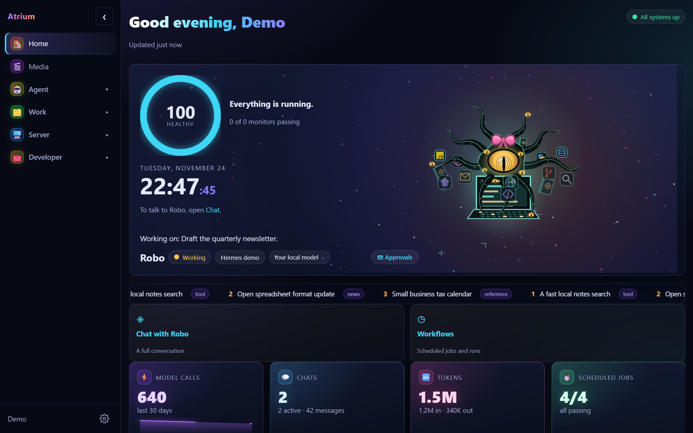
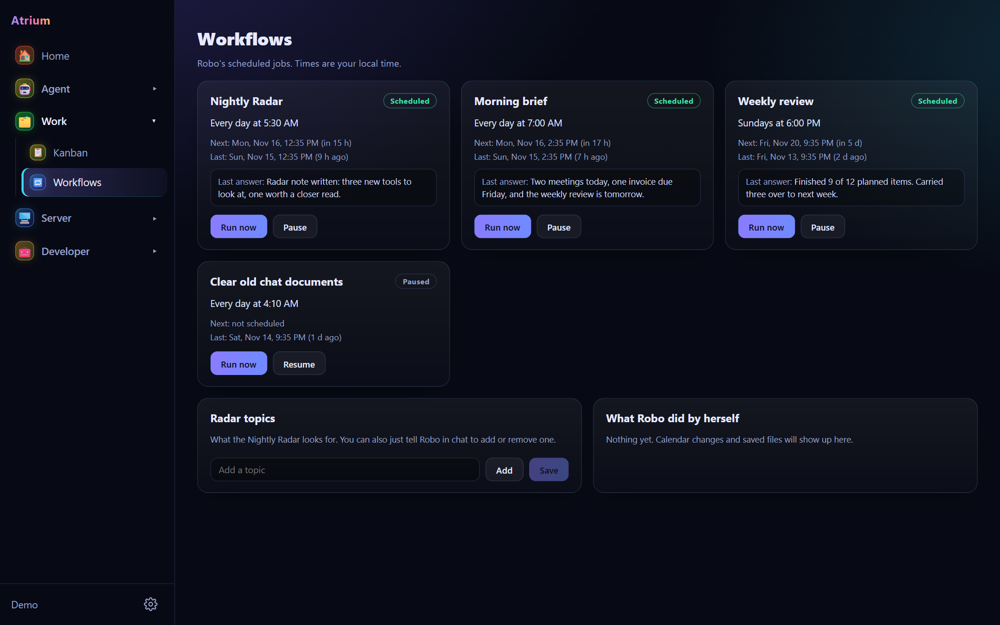
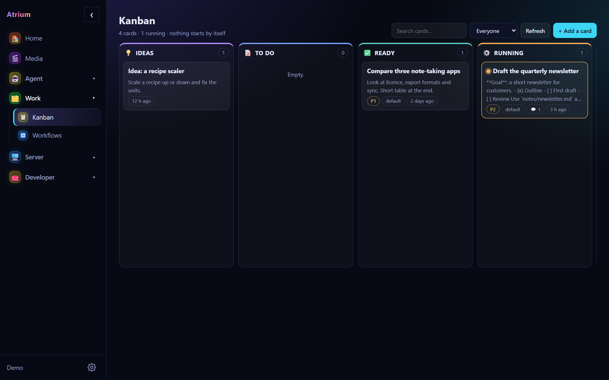

# Atrium: a front end for Hermes Agent

[](https://github.com/ClutchCassidy420/Atrium-Front-End-for-Hermes-Agent/actions/workflows/tests.yml) [](LICENSE)

**A private, installable web app for your AI agent.** Chat, a mission-control home screen, scheduled jobs, a notes graph, a
kanban board, approvals, phone notifications and a coding workspace, in one place, with real sign-in and per-person data.
Built for [Hermes Agent](https://github.com/NousResearch/hermes-agent) and meant to run on your own hardware: no subscription,
no cloud account needed.



| Chat | Memory graph |
| --- | --- |
|  |  |
| **Workflows** | **Kanban** |
|  |  |
| **Server actions** | **Container updates and rollback** |
|  |  |

Works on a phone, too, and installs as an app:


## Try it in two minutes (no agent needed)

The demo runs the real app against a small stand-in for Hermes, with made-up sample data.

```bash
pip install -r requirements.txt
python demo/run_demo.py
```

Open <http://127.0.0.1:8770> and sign in as `demo` / `demo-demo-demo`. Everything the demo creates lives in `demo/.demo-data/`
and is rebuilt on every start. Nothing real is read or sent anywhere.

Pages that need extra services are not part of the demo: the Live agent (a 3D character file), the coding workspace (its sidecar)
and the Room (a model key).

## What is in it

- **Home**: the agent and the work on one screen: health, what needs you, today's focus, the radar of things to look at, the idea pipeline.
- **Chat**: streaming answers with tool activity, past chats, pictures and documents, voice in and read-aloud, approvals in place.
- **Workflows**: scheduled jobs in plain words, with run now, pause, resume, history and the last answer.
- **Memory**: the agent's notes (an Obsidian-style vault) as a graph, with search.
- **Kanban**: a board for the agent's work and your ideas.
- **Agentic coding**: projects, sessions, tool blocks, restore points, files, diffs, a terminal and a shared browser (needs the sidecar in `code-sidecar/`).
- **Live agent**: the agent on a 3D stage that speaks with lip-sync (bring your own character file).
- **Settings, Persona, Avatar, Systems**, notifications, and an optional approval gate for actions you want to confirm.
- **Server actions** (optional): install package updates, update Docker container groups (with a restore point, an automatic rollback if the new build is unhealthy, and a roll back button), reboot or shut down the machine from Settings, with confirmations and a cancel countdown, through a small helper that runs on the host (`host/`).

One login system with users and roles. Everything personal about an install (name, brand, pages, theme, secrets) lives in a separate
**instance folder**, so the same code runs for everyone. See [docs/FRAMEWORK.md](docs/FRAMEWORK.md).

## Install

1. Copy `instance.example/` to a folder of your own and edit `instance.toml` (brand, agent name).
2. Copy `config.private.example` to `config.private.env` and fill in your Hermes address and keys. Never commit it.
3. Start from `deploy/compose.example.yaml`. Put the app behind a reverse proxy and keep it on a private network.
4. Create the first owner with `scripts/manage_users.py` (see the guide).

Read [docs/FRAMEWORK.md](docs/FRAMEWORK.md) before exposing it to anyone. Run `pip install pytest` and then `pytest` to check your copy.

## Status

Early and used daily by its author, on one setup. Expect rough edges. Issues and ideas are welcome.

## About

Atrium was created by Clutch Cassidy / RezWorks Studios and is released under the [MIT License](LICENSE). It is independent of, and not
affiliated with or endorsed by, Nous Research. See [THIRD_PARTY_NOTICES.md](THIRD_PARTY_NOTICES.md) for what it is built with.
