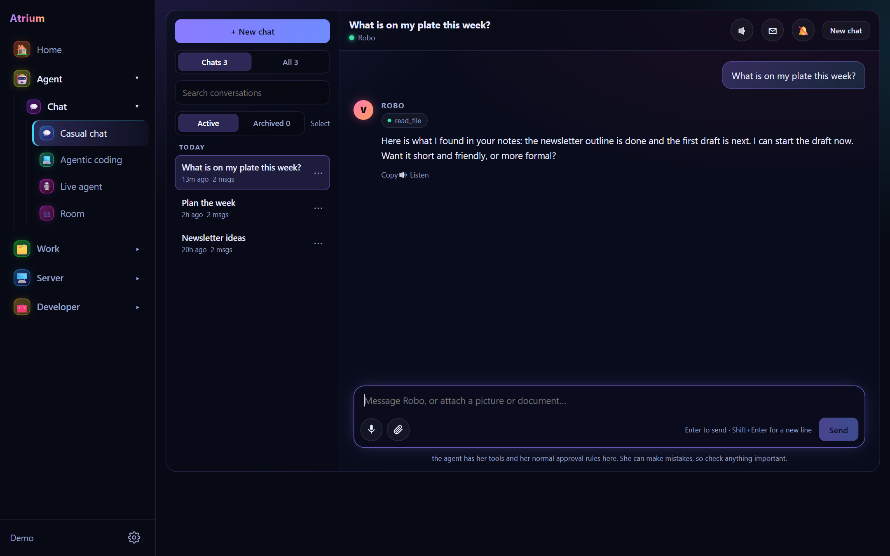
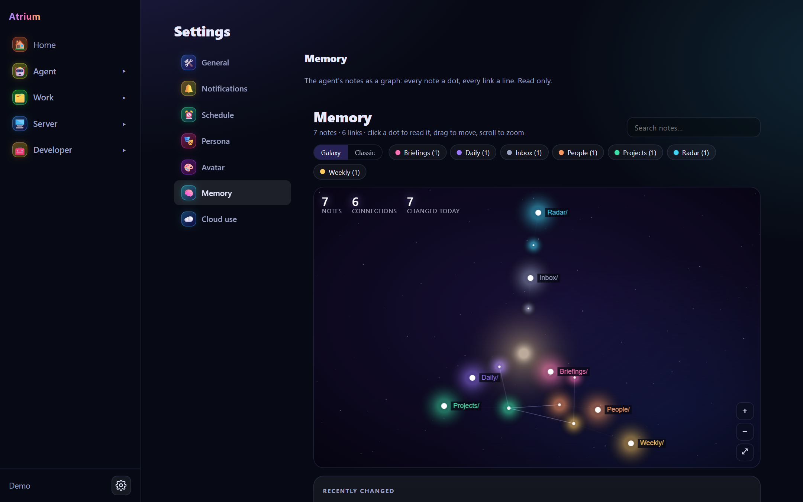
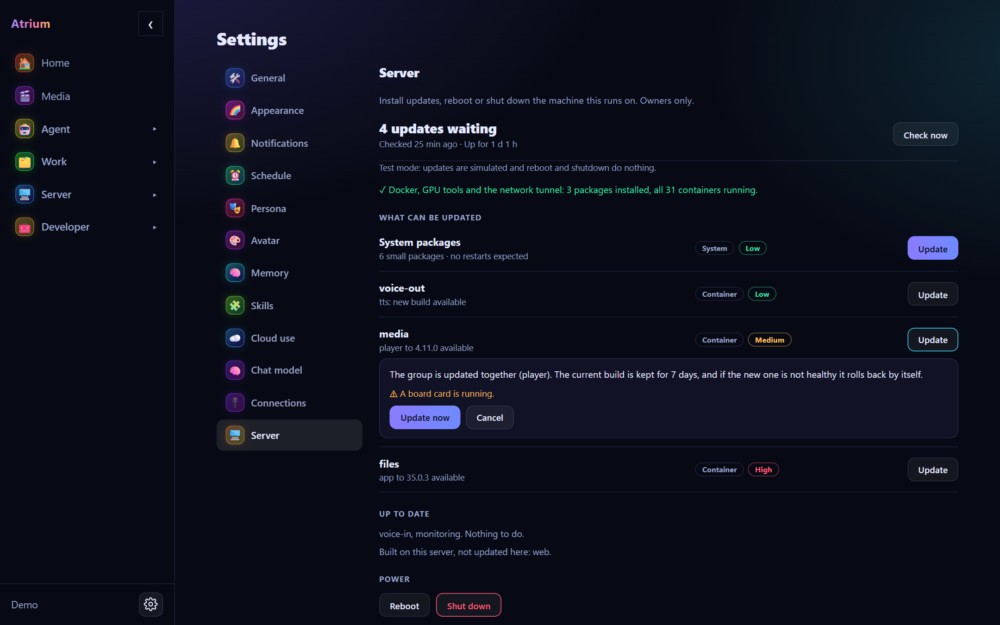
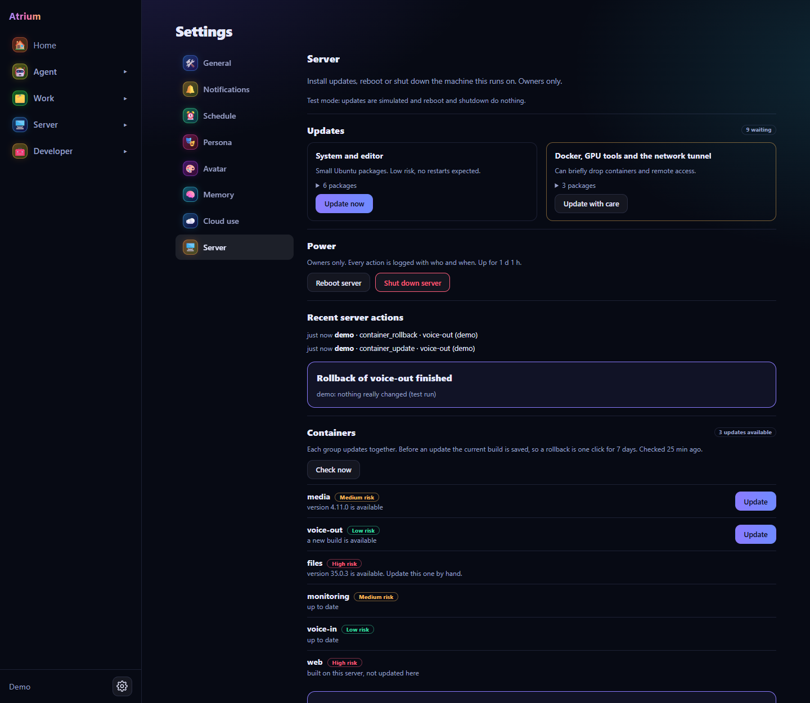
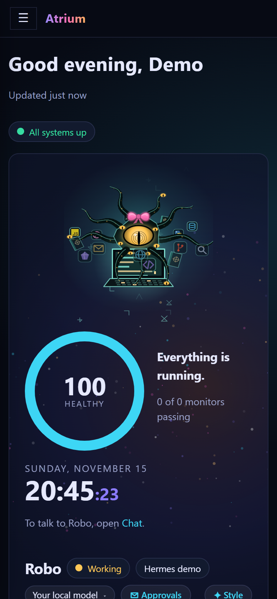

# Atrium: a front end for Hermes Agent

[](https://github.com/ClutchCassidy420/Atrium/actions/workflows/tests.yml) [](LICENSE)

**A private, installable web app for your AI agent.** Chat, a mission-control home screen, scheduled jobs, a notes graph, a
kanban board, approvals, phone notifications, a coding workspace, email, files, calendar and media, in one place, with real sign-in
and per-person data.
Built for [Hermes Agent](https://github.com/NousResearch/hermes-agent) and meant to run on your own hardware: no subscription,
no cloud account needed.


| Chat | Memory graph |
| --- | --- |
|  |  |
| **Workflows** | **Kanban** |
|  |  |
| **Server actions** | **Container updates and rollback** |
|  |  |

Works on a phone, too, and installs as an app:



## Try it in two minutes (no agent needed)

The demo runs the real app against a small stand-in for Hermes, with made-up sample data.

```bash
pip install -r requirements.txt
python demo/run_demo.py
```

Open <http://127.0.0.1:8770> and sign in as `demo` / `demo-demo-demo`. Everything the demo creates lives in `demo/.demo-data/`
and is rebuilt on every start. Nothing real is read or sent anywhere.

Pages that need extra services are not part of the demo: the Live agent (a 3D character file), the coding workspace (its sidecar),
the Room (a model key), Email, Files and Calendar (a mailbox and a Nextcloud), Media (a Jellyfin or Emby server) and REA (its sidecar).

## What is in it

- **Home**: the agent and the work on one screen: health, what needs you, today's focus, the radar of things to look at, the idea pipeline.
- **Chat**: streaming answers with tool activity, past chats, pictures and documents, voice in and read-aloud, approvals in place.
- **Workflows**: scheduled jobs in plain words, with run now, pause, resume, history and the last answer.
- **Memory**: the agent's notes (an Obsidian-style vault) as a graph, with search.
- **Kanban**: a board for the agent's work and your ideas.
- **Agentic coding**: projects, sessions, tool blocks, restore points, files, diffs, a terminal and a shared browser (needs the sidecar in `code-sidecar/`).
- **Email, Files and Calendar** (optional): a mailbox over IMAP and SMTP (one for the install, or each person connects their own, up to five), with images blocked until you choose to show them; and Nextcloud files and calendar over WebDAV and CalDAV, with a reminder you can set on an event.
- **Media** (optional): each person connects their own Jellyfin or Emby server and plays video and music in the page, with a continue-watching banner.
- **REA workbench** (optional, owners only): upload a program or app and run read-only reverse-engineering analyses in a sealed container (needs `rea-sidecar/`).
- **Chat extras**: emoji reactions from people and from the agent, and a UI kit (tables, dialogs, toasts) that new pages share.
- **Live agent**: the agent on a 3D stage that speaks with lip-sync (bring your own character file).
- **Settings, Persona, Avatar, Systems**, notifications, and an optional approval gate for actions you want to confirm.
- **Server actions** (optional): install package updates, update Docker container groups (with a restore point, an automatic rollback if the new build is unhealthy, and a roll back button), reboot or shut down the machine from Settings, with confirmations and a cancel countdown, through a small helper that runs on the host (`host/`).

One login system with users and roles. Everything personal about an install (name, brand, pages, theme, secrets) lives in a separate
**instance folder**, so the same code runs for everyone. See [docs/FRAMEWORK.md](docs/FRAMEWORK.md).

## Install (about five minutes)

You need [Docker](https://docs.docker.com/get-docker/) (Docker Desktop on Windows or Mac, Docker Engine on Linux). Then:

```bash
git clone https://github.com/ClutchCassidy420/Atrium.git
cd Atrium
docker compose up -d --build
docker compose logs atrium
```

1. The last command prints a **setup code** (like `K7QH-2MXD`).
2. Open <http://localhost:8000>. It sends you to a setup page: paste the code and choose your username and password.
3. Sign in. That's it.

Nothing else to create or edit first. By default the app answers only on this computer.

**Connect your agent:** copy `.env.example` to `.env`, fill in your Hermes address and key, and run `docker compose up -d` again.
Without an agent the app still starts; the pages that need one say so.

**More:** email, files and calendar, phone notifications, reaching it from other devices, updating, backups and a hardened
server setup are in [docs/INSTALL.md](docs/INSTALL.md). Want to look around first? Use the [demo](#try-it-in-two-minutes-no-agent-needed).

Read [docs/FRAMEWORK.md](docs/FRAMEWORK.md) before exposing it to anyone. Run `pip install pytest` and then `pytest` to check your copy.

## Status

Early and used daily by its author, on one setup. Expect rough edges. Issues and ideas are welcome.

## About

Atrium was created by Clutch Cassidy / RezWorks Studios and is released under the [GNU Affero General Public License v3.0](LICENSE) (AGPL-3.0).
In plain words: use it, change it and share it; if you run a modified version as a service for other people, you must share your changes under
the same license. Releases up to and including 1.0.0 were published under the MIT License and stay available under it; see the
[changelog](CHANGELOG.md). Copyright (C) 2026 Clutch Cassidy / RezWorks Studios. Atrium is independent of, and not
affiliated with or endorsed by, Nous Research. See [THIRD_PARTY_NOTICES.md](THIRD_PARTY_NOTICES.md) for what it is built with.
